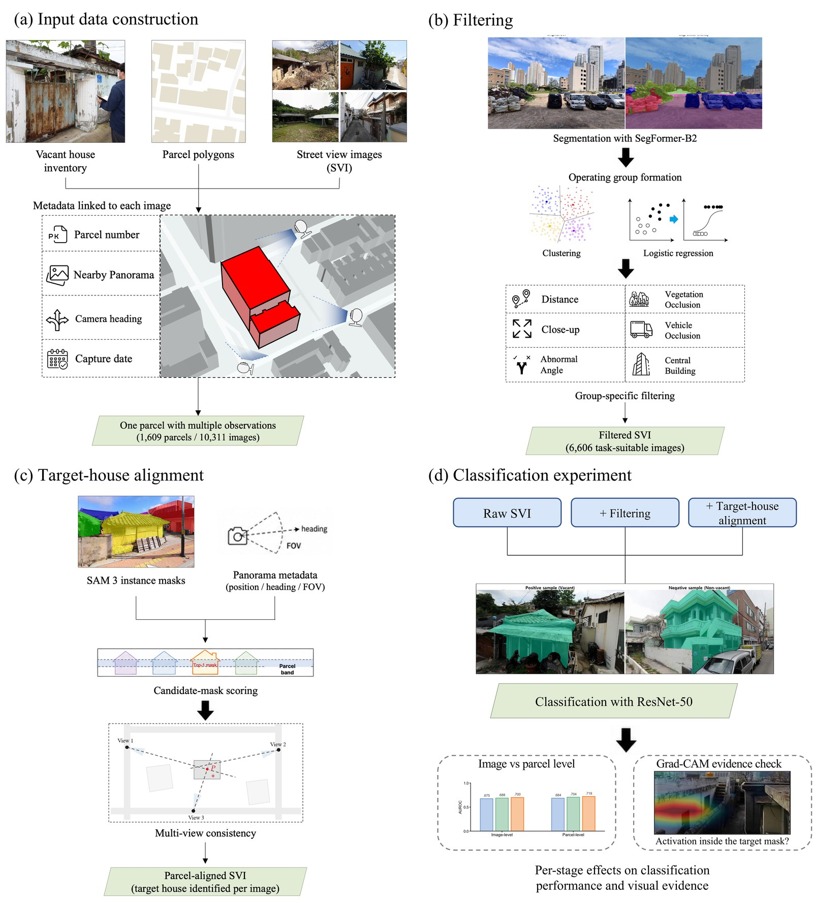

# SVI Pipeline for Vacant House Assessment

Code for *Developing a Street View Imagery Processing Pipeline for Building-Level Vacant House Assessment*.

## Overview

A street view image of a parcel often misses the house or shows the neighbour's. This pipeline takes parcel polygons and street view images and

1. **filters** out images that are unsuitable for the task (SegFormer-B2, group-specific filters),
2. **aligns** each image with its parcel by selecting the mask of the target house (SAM 3, parcel band),
3. **trains** vacancy classifiers on the raw, filtered and aligned images (ResNet-50).

<p align="center">

</p>

## Installation

```bash
git clone https://github.com/gbjun7333/svi-vacant-house-pipeline.git
cd svi-vacant-house-pipeline
pip install -r requirements.txt
```

*Note:* the SAM 3 weights (`facebook/sam3`) need access approval on Hugging Face.

## Quick start

```bash
python run_pipeline.py \
  --images data/images.csv \
  --parcels data/parcels.geojson \
  --work-dir work
```

**Inputs**

`images.csv`, one row per image:

| column | description |
|---|---|
| `image_path` | image file (perspective view, not a 360° panorama) |
| `parcel_id` | parcel the image was taken for |
| `camera_lat`, `camera_lng` | camera position (WGS84) |
| `heading` | compass bearing of the image centre, in degrees |
| `fov` | horizontal field of view, in degrees |
| `platform` | optional, image source |

`parcels.geojson`, one polygon per parcel (EPSG:4326), with properties:

| property | description |
|---|---|
| `parcel_id` | same id as in `images.csv` |
| `label` | `vacant` or `non_vacant` |
| `division` | optional, `Urban` (default) or `Rural` |
| `pair_id` | optional, parcels that share it stay in the same fold |

**Output paths:**  <br />
filtering result: `work/filtering.csv`;  <br />
house masks and the selected mask: `work/masks/`, `work/alignment.csv`;  <br />
dataset and folds: `work/dataset/`;  <br />
models and predictions: `work/runs/`;  <br />
F1 and AUROC: `work/results/table3.csv`.

`--stop-after filter` (or `align`, `dataset`, `train`) ends the run early. Running the same command again picks up where it stopped.

## Citation

To be added.
